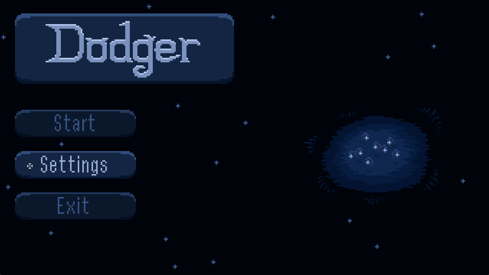
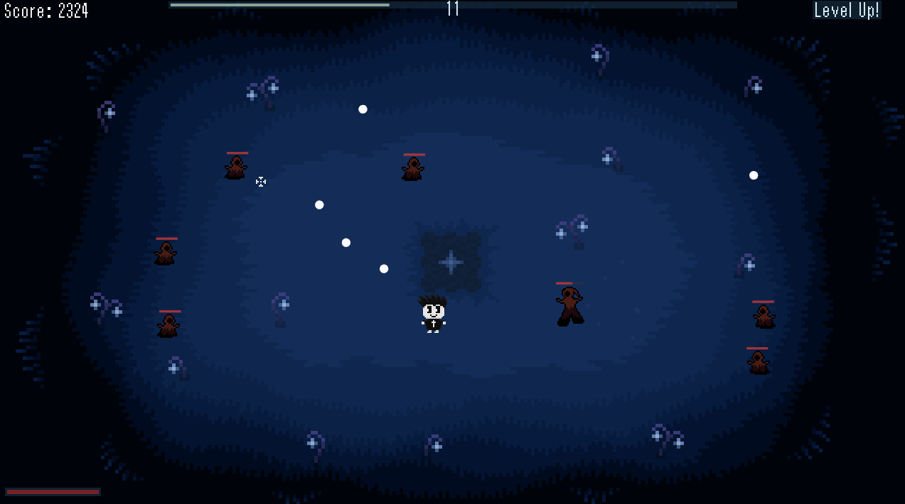
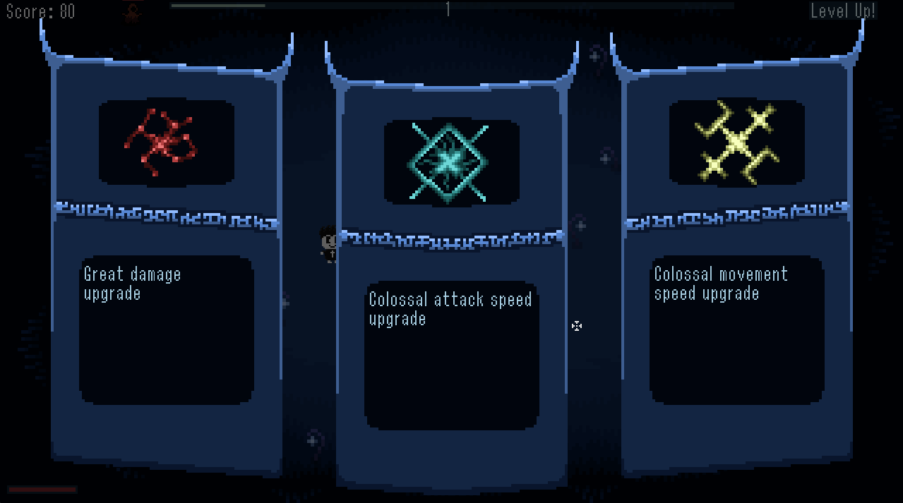

# Dodger

Dodger is a 2D game written in C++ using the SFML library.

---
## Screenshots





---

## Build

### Prerequisites
- CMake (version 3.16 or higher)
- C++ compiler (C++17 support)
- SFML 2.6.1 (is bundled inside `resources/SFML-2.6.1`)

---

### Step 1: Configure the build
Open your terminal in the root directory and set up the build folder:

```powershell
cmake -B build -G "MinGW Makefiles"
```

If you want a release build instead:

```powershell
cmake -B build -G "MinGW Makefiles" -D CMAKE_BUILD_TYPE=Release
```

---

### Step 2: Compile the game
Once configured, build the executable with:

```powershell
cmake --build build
```

---

### Step 3: Run the game
The executable will be placed in the `build/` folder. You can launch it with:

```powershell
cd build 
.\Dodger.exe
```

Or directly from project root:

```powershell
.\build\Dodger.exe
```

---

## Controls

### Attack
- Mouse: Aim and left click to attack.
- Arrow keys: Alternative attack in the chosen direction.

### Movement
- W, A, S, D: Move your character.

### Menus
- Esc: Exit the game.
- P: Pause / unpause.
- Tab: Open the level-up screen.
- R: Restart after defeat.
